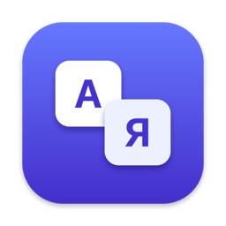
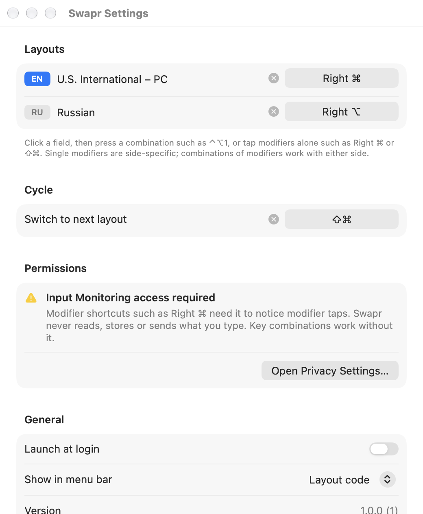
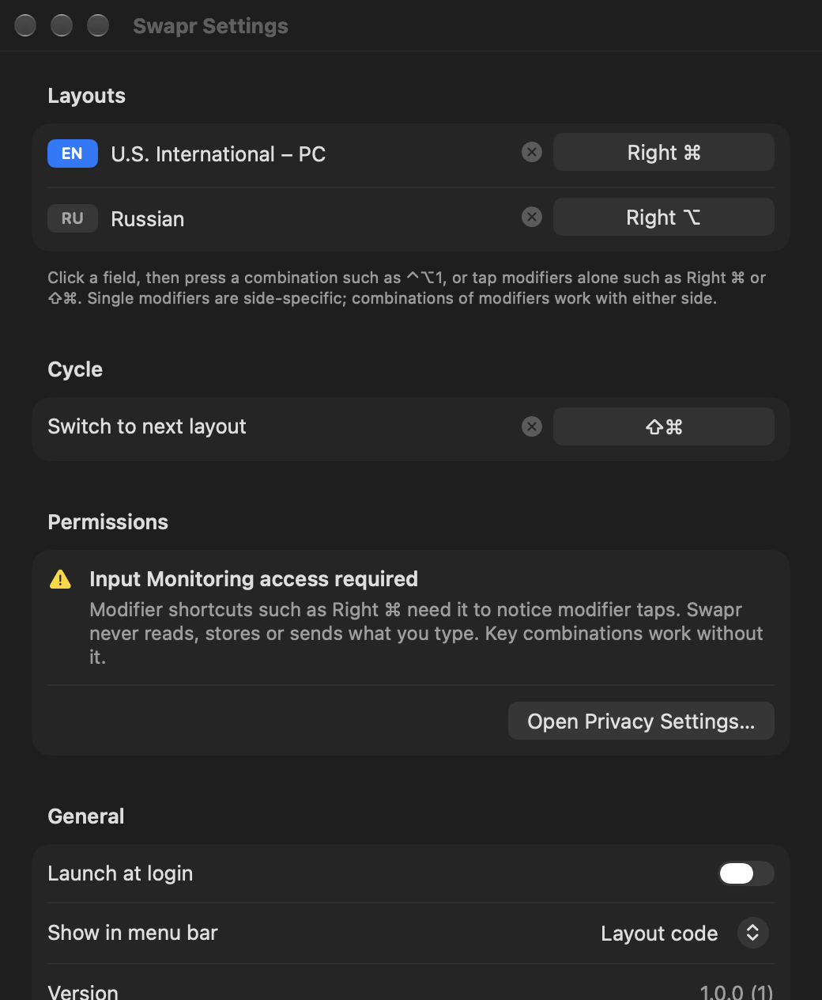

<p align="center">
  
</p>

<h1 align="center">Swapr</h1>

<p align="center">
  Switch keyboard layouts on macOS with shortcuts you choose.<br>
  Tap <b>Right ⌘</b> for English, <b>Right ⌥</b> for Russian — or any shortcut you like.
</p>

<p align="center">
  <a href="https://github.com/devleloper/Swapr/actions/workflows/ci.yml"></a>
  
  
  <a href="LICENSE"></a>
</p>

---

Swapr is a tiny native menu bar app that does one thing: switches the system keyboard layout when you press a global shortcut. No auto-correction, no text analysis, no network — just fast, reliable layout switching.

<p align="center">
  
  &nbsp;
  
</p>

## Features

- **A shortcut for each layout.** Jump straight to the layout you want instead of cycling.
- **Modifier taps.** Tap a single modifier (Right ⌘, Left ⌥, Right ⇧, …) or a chord of modifiers (⇧⌘, ⌃⌥, …) on its own. Taps don't interfere with normal shortcuts: ⇧⌘S still saves.
- **Key combinations.** Classic shortcuts like ⌃⌥1 or F13 — these need no permissions at all.
- **Cycle.** One more shortcut to move to the next layout, with per-layout opt-out.
- **Works with every layout you have enabled** in System Settings, and follows changes live.
- **Conflict checks.** Swapr refuses shortcuts already used by macOS or by another Swapr action, and tells you why.
- **Menu bar.** Shows the current layout code (EN, RU, …), an icon, or nothing at all.
- **Launch at login** via the modern `SMAppService` API.
- **Native and light.** SwiftUI, Dark Mode, Liquid Glass on macOS 26+. Idle CPU usage is 0%, with no polling.
- **Private.** Fully offline, no telemetry, no analytics. Never reads, records or stores what you type.

## Requirements

- macOS 14 Sonoma or later (Apple silicon or Intel)
- Building from source: Xcode 16 or later; Xcode 26 or later for Liquid Glass

## Installation

### Download

1. Download `Swapr-x.y.z.zip` from [Releases](https://github.com/devleloper/Swapr/releases) and unzip it.
2. Move **Swapr.app** to **Applications**.
3. Release builds are ad-hoc signed, not notarized. On first launch, Control-click (right-click) Swapr.app, then choose **Open**. On macOS 15 and later, if no **Open** button appears, go to **System Settings › Privacy & Security** and click **Open Anyway**.

### Build from source

```bash
git clone https://github.com/devleloper/Swapr.git
cd Swapr
./scripts/build-release.sh
```

The app is written to `build/DerivedData/Build/Products/Release/Swapr.app`. See [docs/BUILDING.md](docs/BUILDING.md) for details.

## Usage

1. Launch Swapr. A welcome screen explains the basics. Click **Set Up Shortcuts**.
2. Click the field next to a layout and press a shortcut:
   - **a modifier tap:** press and release Right ⌘ (or ⇧⌘ together), with no other key;
   - **a key combination:** for example ⌃⌥1.
3. If you used a modifier tap, Swapr asks for **Input Monitoring** access. Allow it in System Settings. Swapr picks up the change automatically.
4. Done. Press your shortcut in any app.

In a shortcut field, **⌫** removes the shortcut and **Esc** cancels recording. To reach Settings, use the menu bar item, or launch Swapr again if you hid the menu bar item.

Full guide: [docs/USER_GUIDE.md](docs/USER_GUIDE.md).

## Permissions

| Feature | Permission |
| --- | --- |
| Key combinations (⌃⌥1, F13, …) | None |
| Modifier taps (Right ⌘, ⇧⌘, …) | Input Monitoring |
| Launch at login | Approved by you in Login Items (macOS asks automatically) |

Swapr never asks for Accessibility, Screen Recording or network access. Why Input Monitoring is needed and what Swapr does with it: [docs/PERMISSIONS.md](docs/PERMISSIONS.md).

## Privacy

- No network code at all: no updates check, no telemetry, no crash reporting.
- Modifier taps use a **listen-only** event tap. It cannot change or block input. For ordinary key presses Swapr looks only at the fact that *a* key was pressed, so it can cancel a tap — never at *which* key, and nothing is stored.
- Settings (your shortcuts and preferences) live in `~/Library/Preferences/io.github.devleloper.Swapr.plist`.

## Documentation

- [User guide](docs/USER_GUIDE.md)
- [Permissions](docs/PERMISSIONS.md)
- [Troubleshooting](docs/TROUBLESHOOTING.md)
- [Architecture](docs/ARCHITECTURE.md)
- [Building and releasing](docs/BUILDING.md)
- [Contributing](CONTRIBUTING.md) · [Code of Conduct](CODE_OF_CONDUCT.md) · [Security](SECURITY.md) · [Changelog](CHANGELOG.md)

## License

[MIT](LICENSE) © 2026 Devlet Boltaev
